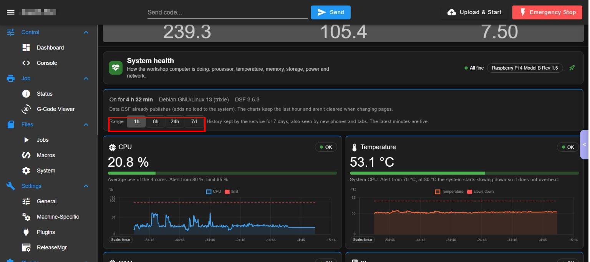
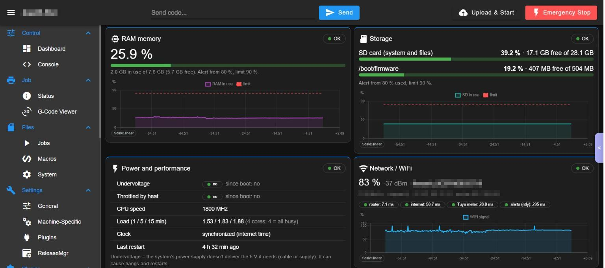
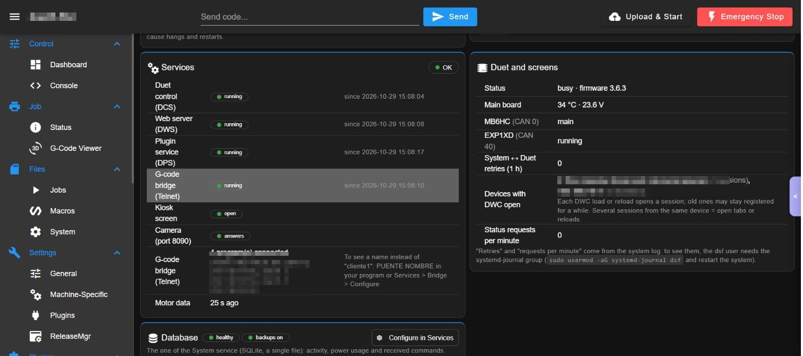
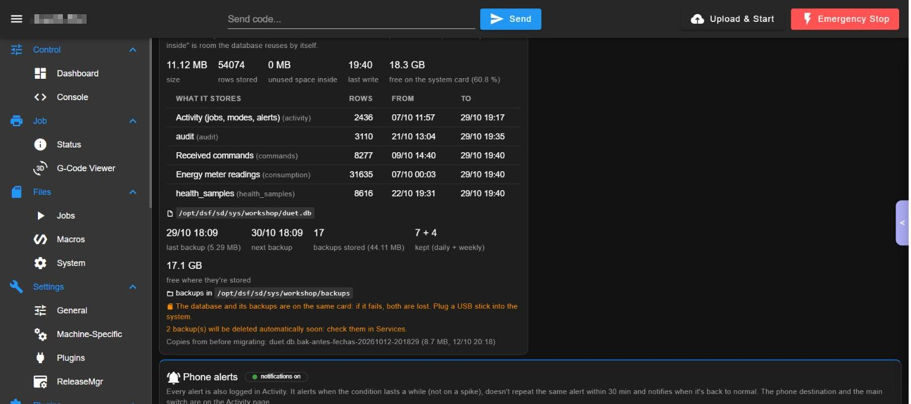
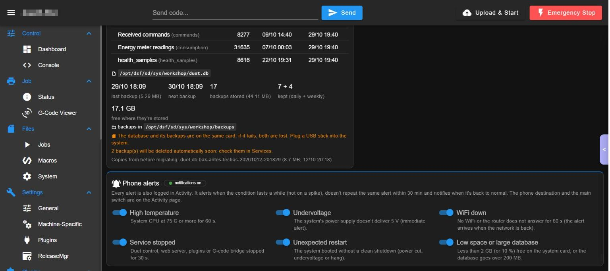

# WorkshopPiHealth (System health)

Page `/Plugins/PiHealth` ("System health"). How the workshop computer (the Raspberry Pi) is doing: CPU, temperature, RAM, storage, power and throttling, network / WiFi, services (DCS, DWS, DPS, G-code bridge, kiosk, camera), Duet and screens, the database and phone alerts. It uses data DSF already publishes (it adds no load). The service stores the history for 7 days (table `health_samples`), also for phones and new tabs; the last minutes are live.

Version documented: 2.4.x on DWC 3.6.3 (Raspberry Pi 4 Model B, Debian 13, DSF 3.6.3).

## 1. Requirements

1. WorkshopService running (stores the samples). 2. Optional: user `dsf` in the group `systemd-journal` (`sudo usermod -aG systemd-journal dsf` and restart) to see "Retries" and "Status requests per minute". 3. For phone alerts: the notification target set in the Activity page.

## 2. Install

1. Install WorkshopService. 2. DWC > Settings > Plugins > Install `WorkshopPiHealth-<ver>.zip`; Start. Reload DWC. 3. Open *Monitor > System health*. 4. Verify: header "All fine", model, uptime, OS and DSF version.

## 3. Functions

The page is "System health" (side menu: Plugins > PiHealth). It is one long page of cards, no side bar.

### Header

#### Summary chip and computer model
- What: a chip with the overall state ("All fine") and the model of the workshop computer (here Raspberry Pi 4 Model B).
- Where: top right of the page header (picture 1).
- How: nothing to press.

#### Uptime and versions
- What: time since the last restart, operating system and DSF version.
- Where: first line under the header (picture 1, "On for ...").
- How: read only.

#### Range of the charts (1h / 6h / 24h / 7d)
- What: the time span of all the charts of the page. The service keeps 7 days of history, also seen by new phones and tabs; the latest minutes are live.
- Where: "Range" buttons under the uptime line (red rectangle, picture 1).
- How: press 1h, 6h, 24h or 7d.
- Watch out: the data is already published by DSF and adds no load to the system.

Picture 1: header, range buttons (red rectangle) and the CPU and Temperature cards.

### Cards

Every card shows a state chip (OK / warning / alarm), the current value, a bar, the alert and limit text and a chart with a dashed limit line and a "Scale: linear" chip.

#### CPU
- What: average use of the 4 cores. Alert from 80 %, limit 95 %.
- Where: left card of the first row (picture 1).
- How: read it; use it to see if the system is overloaded.

#### Temperature
- What: temperature of the system CPU. Alert from 70 C; at 80 C the system starts slowing down so it does not overheat.
- Where: right card of the first row (picture 1).
- How: read it; if it stays high check the fan or the case.

Picture 2: RAM, Storage, "Power and performance" and "Network / WiFi" (network name and addresses blurred).

#### RAM memory
- What: memory in use of the total. Alert from 80 %, limit 90 %.
- Where: picture 2, top left.

#### Storage
- What: use of the SD card (system and files) and of `/boot/firmware`, with free space. Alert from 80 % used, limit 90 %.
- Where: picture 2, top right.
- How: read it; free space before the card fills up (the database and videos live here).

#### Power and performance
- What: Undervoltage (now and since boot), Throttled by heat, CPU speed, Load (1 / 5 / 15 min; with 4 cores, 4 means all busy), Clock synchronized with Internet time, Last restart.
- Where: picture 2, bottom left.
- Watch out: undervoltage means the 5 V supply is too low (cable or supply) and can cause hangs and restarts.

#### Network / WiFi
- What: signal in % and dBm, network name, speed, channel, IP, router, and latency chips to the router, the Internet, the energy meter and the phone-notice service, plus a chart of the signal.
- Where: picture 2, bottom right.
- How: read it; slow or missing latency chips point to the WiFi.
- Watch out: it shows the network name and addresses: blur them before sharing a picture.

Picture 3: "Services" (left) and "Duet and screens" (right); addresses blurred.

#### Services
- What: state and start time of Duet control (DCS), Web server (DWS), Plugin service (DPS) and G-code bridge (Telnet); Kiosk screen (open); Camera port 8090 (answers); the programs connected to the bridge with their names; "Motor data N s ago".
- Where: picture 3, left card.
- How: read it. A stopped service raises the alert "Service stopped".
- Watch out: to see a name instead of "client1" set it in your program or in Services > Bridge > Configure.

#### Duet and screens
- What: Duet state and firmware, main board temperature and voltage, CAN expansion boards (for example EXP1XD "timedOut" when powered off), retries system to Duet in the last hour, DWC sessions per computer and status requests per minute.
- Where: picture 3, right card.
- Watch out: "Retries" and "requests per minute" need the `dsf` user in the `systemd-journal` group (the page shows the command).

Picture 4: the database card.

#### Database
- What: size, rows, unused space, last write and free space of the system database; the list of tables with rows and dates; the backups (last, next, how many, 7 daily + 4 weekly kept, free space); warnings when the database and its backups are on the same card and when old backups will be deleted; copies kept from before a migration.
- Where: card "Database" below the Services card (picture 4); the button "Configure in Services" at its top right opens the Service page.
- How: read it; use "Configure in Services" to change backups.
- Watch out: if the card fails both the database and the backups are lost: plug a USB stick.

Picture 5: the "Phone alerts" card with its six switches.

#### Phone alerts
- What: six switches choose what notifies the phone: High temperature (CPU 75 C or more for 60 s), Undervoltage (immediate), WiFi down (60 s; arrives when the network returns), Service stopped (30 s), Unexpected restart (boot without a clean shutdown), Low space or large database (under 2 GB or 10 % free, or over 200 MB).
- Where: last card of the page (picture 5).
- How: 1. Set the phone destination and the main switch on the Activity page. 2. Turn each switch on or off here.
- Watch out: an alert is sent when the condition lasts (not for a spike), never repeated within 30 min, and one more when it returns to normal; each is also stored in Activity.

## 4. Settings

The page is read-only. Thresholds are fixed (CPU 80 / 95 %, temperature 70 / 80 C, RAM 80 / 90 %, storage 80 / 90 %). Alerts on / off and the phone target are set in the Activity page; types in `notifications.type`.

## 5. Roles

Any role can read. Changing alert types is technician or admin. Without users: admin.

## 6. API operations used

`health.history`, `notifications.type`, `view.heartbeat`; live values come from the object model published by the service.

## 7. Troubleshooting

1. Undervoltage "yes": change the Pi supply or cable and do not share it with motors or the heated bed.
2. Temperature over 70 C: improve cooling.
3. "Retries" shows a hint about `systemd-journal`: add `dsf` to that group.
4. Charts empty after an update: the history is kept 7 days; wait for new samples.
5. "The system shut down uncleanly" (black box) appears in the service page after a power cut: see the black box there.

<!-- permissions:start -->

## Permissions and what it changes

Risk: **Low**. Read this before installing; the full document is `security.md` of the Workshop plugins.

**DSF permissions:** none. It is a page of DWC (it runs in your browser) and everything it does goes through the API of `WorkshopService`, which applies the roles (viewer, operator, technician, administrator) in the server.

**Depends on:** `WorkshopService` (install it first, uninstall it last).

**Files it writes:**
- its history in the plugin data and the service database

**Safety notes:**
- It reads the Pi (temperature, memory, Wi-Fi, services); it changes nothing.

Uninstalling removes the plugin folder; your data in `0:/sys/workshop/` and `/opt/dsf/conf/workshop-*.json` stays.

<!-- permissions:end -->

## 8. Limits

Raspberry Pi only; data are those DSF publishes plus the service samples; the history is 7 days.

